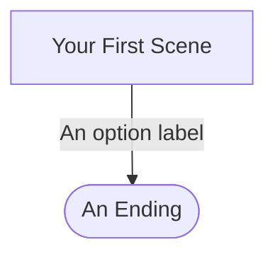
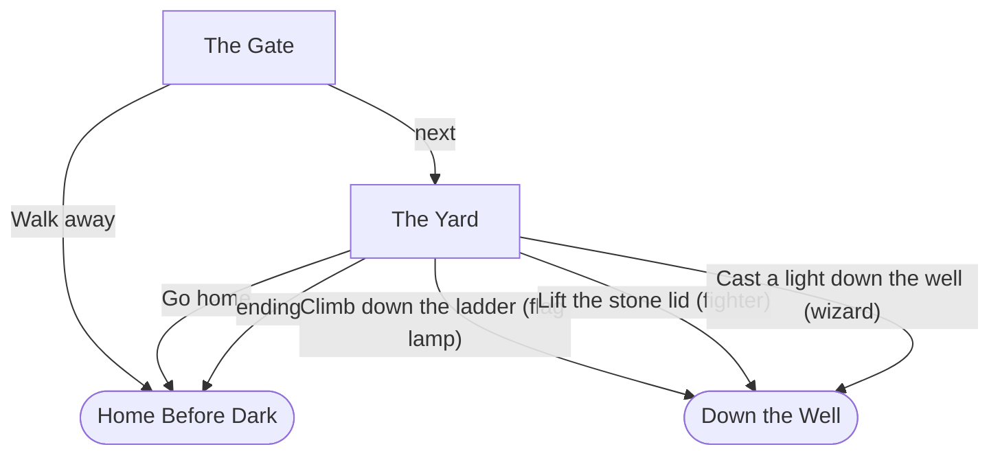

# Blueprint: (your story's title)

Story file: `stories/story.json`. Copy this file to `cyoa_kit/stories/blueprint.md`. Leave every heading exactly as it is. Replace every line in *italics* with your own words. Write it yourself: no AI on the blueprint.

Worked examples with the same headings: `cyoa_kit/stories/fort_blueprint.md` and `cyoa_kit/stories/dead_drop_blueprint.md`.

**Order of work.** Write sections 1 to 3 first (who plays it, the lever, the user stories). Then draw the map (section 4). Then write `story.json`. Then run `python3 checker.py stories/story.json` and fix what it finds. Fill sections 5 to 10 as you go.

---

## 1. The pitch

*One sentence: who plays it, what they do, and how long it takes.*

*Example shape: "A first-time player [does what], [where], in about five minutes."*

## 2. The lever

| | |
|---|---|
| Field | `role` |
| Set where | *Scene `____` (your start scene), group `____`* |
| Values | *`____` and `____` (two values; three are allowed)* |
| What `____` opens | *Scene / group / option: what only this value can see.* |
| What `____` opens | *Scene / group / option: what only this value can see.* |
| Why it matters | *One or two sentences: how the game plays differently for each value.* |

## 3. User stories

*Write 3 to 6 stories. At least one is about the lever. Each one has three parts.*

**US-1. *(a short name)*.**
As a player, I want *(something)*, so that *(a reason)*.
Given *(where I am, and what I did before)*, When *(I pick this option)*, Then *(what I see or where I go)*.
Check: *(a checker line, such as `OK lever: scene '...' sets role to ... or ....`, or a golden run, such as `tests/story_escaped.out`)*.

**US-2. *(a short name)*.**
As a player, I want ..., so that ....
Given ..., When ..., Then ....
Check: ....

**US-3. *(a short name)*.**
As a player, I want ..., so that ....
Given ..., When ..., Then ....
Check: ....

**US-F. *(your build feature; add this at the gate, before you ask an AI for any code)*.**
As a player, I want ..., so that ....
Given ..., When ..., Then ....
Check: ....

*A good Given/When/Then names a real scene, a real option label, or a real ending. "Then it works" is not a criterion. "Then I see 'Force the door'" is.*

## 4. The map

Scenes are boxes. Endings are rounded. An edge with a condition in parentheses only shows when the condition is true.

### Mermaid conventions

| Thing | How to write it | Example |
|---|---|---|
| The first line | `flowchart TD` | `flowchart TD` |
| A scene | `id["Title"]` (square brackets: a box) | `gate["The Gate"]` |
| An ending | `id(["Title"])` (round inside square: a rounded box) | `home(["Home Before Dark"])` |
| An option with `to` | An edge labelled with the option's label, in double quotes | `gate -->|"Walk away"| home` |
| An option with a `when` | The label, then the condition in parentheses | `yard -->|"Lift the stone lid (fighter)"| treasure` |
| A flag condition | `(flag name)` | `yard -->|"Climb down the ladder (flag lamp)"| treasure` |
| A scene's `next` | An edge labelled `next` | `gate -->|next| yard` |
| A scene's `ending` | An edge labelled `ending` | `yard -->|ending| home` |
| A scene's `route` | One edge per entry, labelled with its condition; the last one `"otherwise"` | `phone -->|"flag bad"| debrief` |

Use the **id**, not the title, on the left of each line. Put a label in double quotes when it holds parentheses or a comma: without quotes, `(` breaks the diagram. GitHub draws the map when you view `blueprint.md` on github.com.

### A worked snippet: *The Locked Gate*

This is the map for the tiny example story in `STORY-FORMAT.md`, section 9 (`stories/toy.json`).

Read it this way. "Take the lamp" has no `to`, so it draws no edge; it sets the flag `lamp`, and the flag shows up later as `(flag lamp)`. The lever (`role`) draws no edge either; it shows up as `(fighter)` and `(wizard)` on the options it opens.

## 5. Scenes

| id | title | what happens | exits |
|---|---|---|---|
| *`____`* | *____* | *One or two sentences.* | *Each `to`, then `next`, `ending` or `route`.* |
| | | | |
| | | | |
| | | | |
| | | | |
| | | | |

*6 to 15 scenes. Add rows as you need them.*

## 6. Endings

| id | title | how you reach it |
|---|---|---|
| *`____`* | *____* | *One sentence.* |
| | | |
| | | |

*At least 3 endings. Say which one is the best ending, if there is one.*

## 7. State

| name | kind | set by | tested by |
|---|---|---|---|
| `role` | field | *scene / group / option* | *scene / group / option, and any beats* |
| *`____`* | flag | | |
| | | | |

*Kind is field, meter or flag. Write "set by" and "tested by" as scene / group / option. A flag that is set but never tested does nothing: the checker warns about it.*

## 8. Cut list

| Item cut | Reason | Revisit when |
|---|---|---|
| *An idea you had and left out.* | *Why it is out of this version.* | *What would have to be true to bring it back. "Never" is a fine answer.* |
| | | |
| | | |

*At least 3 rows. Cutting is a decision, not a failure.*

## 9. Definition of Done

- [ ] `python3 checker.py stories/story.json` ends `RESULT: PASS`.
- [ ] The checker shows *__* scenes (6 to 15) and *__* endings (at least 3), with no rule 20 warning.
- [ ] Each role reaches at least one ending. *(Copy the checker's `OK role ... reaches:` lines here.)*
- [ ] Every user story has a criterion and a check, and every check names a checker line or a golden run.
- [ ] One golden run for each ending I claim: *`tests/story_____.in`, ...*
- [ ] `python3 tests/run_tests.py` ends `ALL TESTS PASSED`.
- [ ] A classmate played it and signed the playtest form.

## 10. Sources and new inventions

| Part | Where it comes from |
|---|---|
| *The idea for the story* | *Your own, or "inspired by ____" (a book, a game, a film). Say so.* |
| *Any text you did not write yourself* | *Where it came from. AI may not write story text.* |
| **New:** *what you invented* | *Written by me.* |

---

**Changes after the gate.** *Add a dated note here each time you change the story after Tue 11/24/26: what changed, and why. Write it yourself.*
